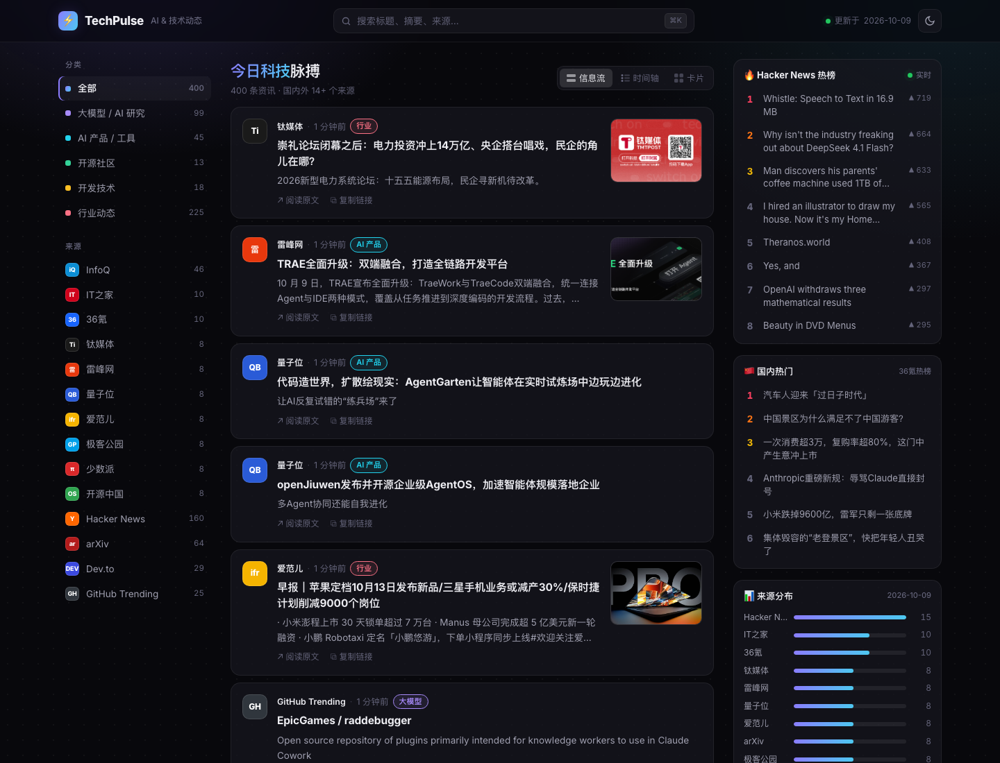
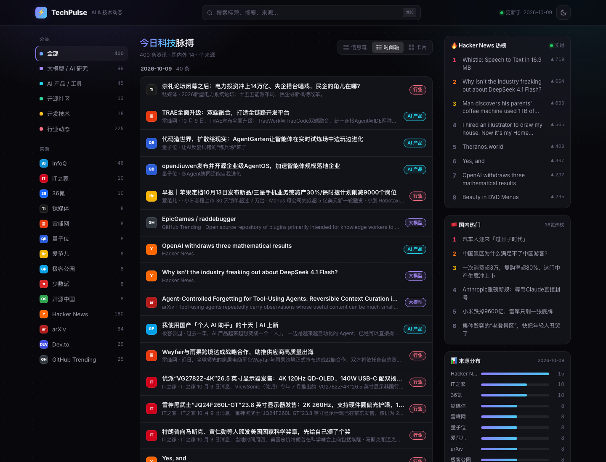

# ⚡ TechPulse · AI & 技术动态

> 自动聚合国内外 AI 与互联网技术资讯（36氪、IT之家、量子位、Hacker News、GitHub Trending 等 14 个来源），由 Claude Code 驱动

**🌐 在线访问：[https://climb0516.github.io/tech-news/](https://climb0516.github.io/tech-news/)**

---

## 截图

**信息流视图** — 社区风格三栏：左侧分类 / 来源筛选，中间信息流，右侧热榜与统计



**时间轴视图** — 按日期分组的紧凑列表，快速扫读



**卡片视图** — 精选封面 + 全部资讯分区展示


---

## 功能特性

- **国内外 14 个来源**：9 个国内科技媒体 + 5 个海外技术社区，每天 09:00（北京时间）自动抓取
- **AI 精选**：通过 `/go-tech-news` Skill 调用 Claude 搜索、筛选、摘要，写入数据库
- **社区风格界面**：三栏布局，来源头像 + 分类标签 + 封面缩略图，悬停渐变描边；默认深色，可一键切换浅色
- **三种视图**：信息流（帖子式，带摘要和封面）/ 时间轴（紧凑列表）/ 卡片（封面优先），选择会被记住
- **组合筛选**：分类单选 + 来源多选，左侧实时显示每项条数
- **全文搜索**：按标题、摘要、来源过滤，快捷键 `⌘K` / `Ctrl K`，`Esc` 清空
- **右侧挂件**：Hacker News 实时热榜、国内热门（36氪热榜）、当日来源分布
- **加载更多**：一次读取最近 400 条，每页显示 40 条
- **手机适配**：单栏布局，分类与来源变成可横向滑动的标签

---

## 技术架构

```
Claude Code (Skill)
  ↓ WebSearch 搜索 + AI 摘要
  ↓ 写入 Supabase (type='ai')
  ↓ git push last_ai_update.txt
       ↓
GitHub Actions (触发条件：定时 / push / 手动)
  ↓ 运行 scraper.py
  ↓ 抓取 14 个数据源（国内 9 + 海外 5）
  ↓ 写入 Supabase (type='scraped')
       ↓
GitHub Pages (index.html)
  ↓ 前端直连 Supabase REST API
  ↓ 实时渲染页面
```

---

## 数据来源

**国内**

| 来源 | 方式 | 每次条数 | 封面图 |
|------|------|---------|--------|
| 36氪 | 网页端热榜接口（原 RSS 已被人机验证拦截） | 10 | ✅ |
| IT之家 | RSS | 10 | ✅ |
| 少数派 | RSS | 8 | — |
| 爱范儿 | RSS | 8 | ✅ |
| 量子位 | RSS | 8 | — |
| 极客公园 | RSS | 8 | ✅ |
| 钛媒体 | RSS | 8 | ✅ |
| 雷峰网 | RSS | 8 | 部分 |
| 开源中国 | RSS | 8 | — |
| InfoQ | RSS | 8 | — |

**海外**

| 来源 | 方式 | 每次条数 | 说明 |
|------|------|---------|------|
| Hacker News | Algolia API | 15 | 另有页面右侧实时热榜 |
| Dev.to | REST API | 12 | 含封面图 |
| GitHub Trending | 网页解析 | 10 | 每日热门仓库 |
| arXiv cs.AI | RSS | 8 | AI 论文，自动去掉 "Announce Type" 前缀 |
| Claude WebSearch | AI 精选 | — | 手动触发，质量更高 |

**新增 / 删除 RSS 源**：编辑 `scraper.py` 里的 `CN_FEEDS` 列表（地址, 显示名, 条数）；如需自定义头像颜色，改 `index.html` 里的 `SRC` 映射。

**分类规则**：按标题和摘要中的中英文关键词自动归类（如"大模型 / DeepSeek / 通义"→ 大模型，"开源 / GitHub"→ 开源社区，"鸿蒙 / 前端 / 数据库"→ 开发技术），见 `categorize()`。

**图片防盗链**：国内图床大多校验 Referer，前端图片统一加 `referrerpolicy="no-referrer"`。

---

## 数据库

使用 **Supabase** PostgreSQL，表结构：

```
news_items
├── id           bigint (主键)
├── category     text   (A-E 分类)
├── title        text   (唯一，用于去重)
├── source       text
├── summary      text
├── url          text
├── date         text
├── image_url    text
├── type         text   ('ai' | 'scraped')
└── created_at   timestamptz
```

---

## 本地运行爬虫

```
python scraper.py
```

---

## 自动更新机制

| 触发方式 | 时机 |
|---------|------|
| GitHub Actions 定时任务 | 每天 09:00 北京时间（仓库 60 天无提交会被 GitHub 自动停用，需在 Actions 页面重新启用） |
| 任意 push 到 main 分支 | 推送后约 1-2 分钟 |
| GitHub Actions 手动 dispatch | 按需触发 |
| `/go-tech-news` Skill | 执行后自动 push 触发爬虫 |
