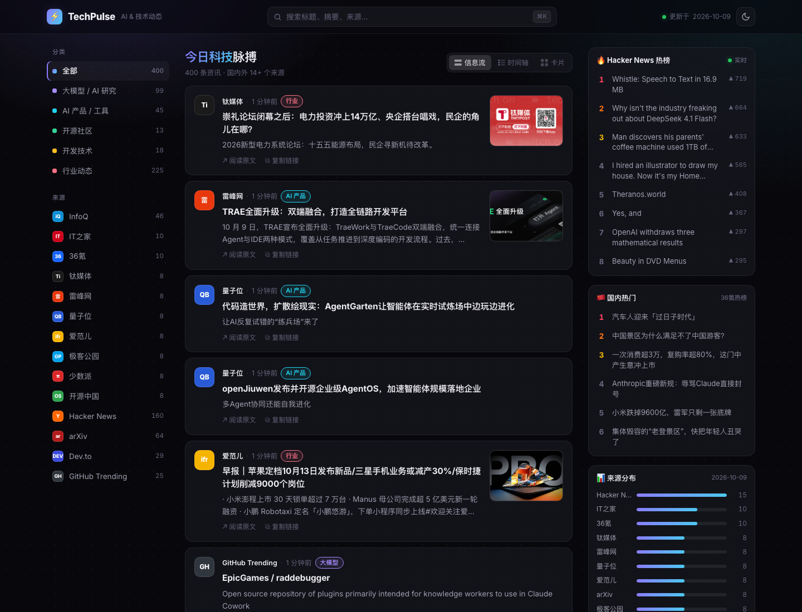
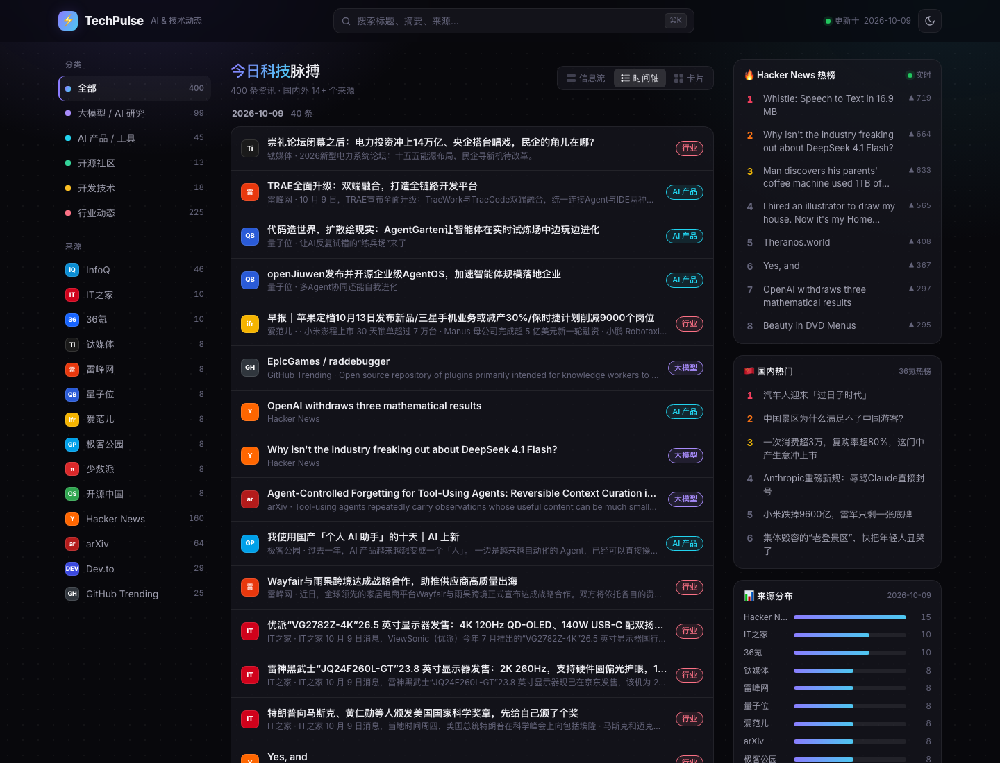

# ⚡ TechPulse · AI & 技术动态

> 自动聚合国内外 AI 与互联网技术资讯（36氪、IT之家、量子位、Hacker News、GitHub Trending 等 14 个来源），由 Claude Code 驱动

**🌐 在线访问：[https://climb0516.github.io/tech-news/](https://climb0516.github.io/tech-news/)**

---

## 截图

**信息流视图** — 社区风格三栏：左侧分类 / 来源筛选，中间信息流，右侧热榜与统计



**时间轴视图** — 按日期分组的紧凑列表，快速扫读



**卡片视图** — 精选封面 + 全部资讯分区展示


---

## 功能特性

- **国内外 14 个来源**：9 个国内科技媒体 + 5 个海外技术社区，每天 09:00（北京时间）自动抓取
- **AI 精选**：通过 `/go-tech-news` Skill 调用 Claude 搜索、筛选、摘要，写入数据库
- **社区风格界面**：三栏布局，来源头像 + 分类标签 + 封面缩略图，悬停渐变描边；默认深色，可一键切换浅色
- **三种视图**：信息流（帖子式，带摘要和封面）/ 时间轴（紧凑列表）/ 卡片（封面优先），选择会被记住
- **组合筛选**：分类单选 + 来源多选，左侧实时显示每项条数
- **全文搜索**：按标题、摘要、来源过滤，快捷键 `⌘K` / `Ctrl K`，`Esc` 清空
- **右侧挂件**：Hacker News 实时热榜、国内热门（36氪热榜）、当日来源分布
- **加载更多**：一次读取最近 400 条，每页显示 40 条
- **手机适配**：单栏布局，分类与来源变成可横向滑动的标签

---

## 技术架构

```
Claude Code /go-tech-news Skill（手动执行）
  ↓ WebSearch 并发 9 条检索（+ 可选关键词 1 条）→ Claude 筛选 / 去重 / A-E 分类 / 中文摘要
  ↓ Bash 内联 Python：POST Supabase news_items（type='ai'，标题重复自动跳过）
  ↓ 写 last_ai_update.txt 并 git push（心跳，见「自动更新机制」）
       ↓
GitHub Actions（每天 09:00 北京时间 / 手动 dispatch / 修改 scraper.py 或 workflow 后 push）
  ↓ python scraper.py（只用标准库）
  ↓ 抓取 14 个来源（国内 10 + 海外 4）→ categorize() 关键词分类 → 同批标题去重
  ↓ POST Supabase news_items?on_conflict=title（type='scraped'，忽略重复）
  ↓ 写 last_scrape.txt 并 commit（心跳）
       ↓
GitHub Pages（index.html）
  ↓ 前端直连 Supabase REST API（首屏 400 条，按 offset 继续翻页）+ 直连 HN Algolia 实时热榜
  ↓ 信息流 / 时间轴 / 卡片三种视图
  ↓ kit 详情抽屉（#/item/news/<id>、#/item/hn/<id>）+ 列表页（#/list/src/<来源>、#/list/cat/<A-E>、#/list/hn）
```

---

## 数据来源

**国内**（共 10 个）

| 来源 | 方式 | 每次条数 | 备注 |
|------|------|---------|------|
| 36氪 | 接口：`gateway.36kr.com` 网页端热榜（POST） | 10 | 原 RSS 被人机验证拦截；带封面 `widgetImage` |
| IT之家 | RSS | 10 | |
| 少数派 | RSS | 8 | |
| 爱范儿 | RSS | 8 | |
| 量子位 | RSS | 8 | |
| 极客公园 | RSS | 8 | |
| 钛媒体 | RSS | 8 | |
| 雷峰网 | RSS | 8 | |
| 开源中国 | RSS | 8 | |
| InfoQ | RSS | 8 | |

RSS 的封面图按顺序取：description / content:encoded 里第一张 `` → `enclosure`（image 类型）→ `media:content`，见 `fetch_rss()`。

**海外**（共 4 个）

| 来源 | 方式 | 每次条数 | 备注 |
|------|------|---------|------|
| Hacker News | 接口：Algolia `search?tags=front_page` | 15 | 摘要写成「▲ N 分 · M 条评论」，前端解析成分数 / 评论数 |
| Dev.to | 接口：`/api/articles?top=7` | 12 | 封面取 `cover_image` / `social_image` |
| GitHub Trending | 网页解析：`github.com/trending?since=daily` | 10 | 摘要末尾拼「｜ ★ 星标 · 今日 +N · 语言」，前端解析 |
| arXiv cs.AI | RSS：`rss.arxiv.org/rss/cs.AI` | 8 | 固定归入分类 A；去掉 "arXiv:xxx Announce Type: … Abstract:" 前缀 |

**AI 精选**：`/go-tech-news` Skill 用 WebSearch 检索后写入，`type='ai'`，每个分类最多 5 条（见「Skill 流程」）。

**增删来源**：
- 国内 RSS：改 `scraper.py` 里的 `CN_FEEDS` 列表，每项是 `(RSS 地址, 显示名, 条数)`
- 接口 / 网页类来源：各自一个 `fetch_xxx(limit)` 函数（`fetch_hn` / `fetch_devto` / `fetch_github_trending` / `fetch_arxiv` / `fetch_36kr`），在 `__main__` 里 `all_items += fetch_xxx()` 注册
- 头像颜色 / 简称：改 `index.html` 里的 `SRC` 映射

---

## 数据处理规则

- **分类** `categorize(title, summary)`：标题 + 摘要转小写后按顺序匹配关键词，先命中先生效
  - A 大模型 / AI 研究：llm、gpt、claude、deepseek、qwen、transformer、benchmark、大模型、多模态、通义、豆包、论文、算力、具身智能…
  - B AI 产品 / 工具：chatgpt、copilot、cursor、openai、anthropic、agent、智能体、AI 助手、AIGC…
  - C 开源社区：open source、github、hugging face、ollama、pypi、开源、代码仓库…
  - D 开发技术：react、vue、swift、kotlin、rust、docker、kubernetes、database、前端、后端、鸿蒙、云原生、编译器…
  - E 行业动态：以上都没命中的兜底
  - arXiv 不走关键词，固定为 A
- **摘要清洗**：`truncate()` 去 HTML 标签、合并空白、截断到 500 字；`make_item()` 中摘要与标题相同时置空（前端不重复显示）
- **去重**：
  - 同一批次内按标题去重，只保留第一次出现的（`__main__` 里的 `seen` 集合），否则 Supabase 批量 upsert 会因同批重复报错
  - 跨批次靠数据库 `title` 唯一约束 + `on_conflict=title` + `Prefer: resolution=ignore-duplicates`，已存在的标题直接跳过
- **日期**：爬虫条目的 `date` 统一写抓取当天（UTC 日期 `TODAY`），不是原文发布时间
- **图片防盗链**：国内图床大多校验 Referer，前端图片统一加 `referrerpolicy="no-referrer"`
- **前端清洗**：`cleanRows()` 再去一次旧 arXiv 摘要前缀；`parseStats()` 从摘要里解析 HN 分数 / 评论数、GitHub 星标 / 今日新增 / 语言

---

## 数据结构

**Supabase**（PostgreSQL）表 `news_items`：

```
news_items
├── id           bigint       主键（前端详情地址 #/item/news/<id> 用它）
├── category     text         A-E 分类
├── title        text         唯一，用于去重
├── source       text         来源显示名（36氪 / Hacker News / …；AI 精选为实际媒体名）
├── summary      text         摘要（HN / GitHub 条目里拼了统计信息）
├── url          text
├── date         text         YYYY-MM-DD
├── image_url    text         封面，可为空
├── type         text         'ai' | 'scraped'
└── created_at   timestamptz  收录时间（前端排序用 date.desc,created_at.desc）
```

连接配置：`scraper.py` 的 `SUPABASE_URL` / `ANON_KEY`，`index.html` 的 `SUPABASE_URL` / `SUPABASE_KEY`（anon key，只读写 `news_items`）。数据库不设条数上限，历史永久保留。

**data.json**（历史遗留，前端和爬虫都不再读写）：项目初期的静态数据，结构如下，现已被 Supabase 取代：

```
{
  "updated": "2026-06-09",
  "items": [
    { "category": "A", "title": "…", "source": "…", "summary": "…", "url": "…", "date": "2026-06-09" }
  ]
}
```

**心跳文件**：
- `last_scrape.txt`：workflow 每次跑完写入北京时间 `YYYY-MM-DD HH:MM:SS` 并提交
- `last_ai_update.txt`：Skill 每次执行写入 UTC 时间 `YYYY-MM-DDTHH:MM:SSZ` 并 push

---

## 前端

**kit 详情抽屉 / 列表页**：点任意条目，电脑上从右侧滑出详情抽屉，手机上从底部升起；地址同步成 `#/item/<类型>/<id>`，列表页是 `#/list/<key>`。地址可以直接分享，打开分享链接会直接弹出详情；按浏览器返回 = 关闭抽屉。条目已下榜 / 过期 / 不在当前数据里时，弹出「这条内容已不在当前数据里」的提示，而不是空白。

| 类型 | 地址 | 内容 |
|------|------|------|
| 资讯详情 | `#/item/news/<news_items.id>` | 摘要、来源 / 分类 / 日期 / 收录时间、同来源 6 条、同分类 6 条；不在已加载的 400 条里时按 id 单独查 Supabase（`fetchOne()`） |
| HN 帖子详情 | `#/item/hn/<objectID>` | 正文、作者 / 分数 / 评论、HN 首页其它热帖；按 id 调 Algolia `tags=story_<id>` |
| 来源列表 | `#/list/src/<来源名>` | 该来源全部收录，按收录时间倒序，远程分页 |
| 分类列表 | `#/list/cat/<A-E>` | 该分类全部收录 |
| HN 热榜列表 | `#/list/hn` | HN 首页 30 条实时热榜，可按首页排序 / 分数 / 评论 / 最新排序 |

**本项目特有**：
- 三栏布局，三种视图（信息流 / 时间轴 / 卡片），视图与主题存在 `localStorage`（`tp-view` / `tp-theme`）
- 首页一次读 400 条（`PAGE = 400`），滚动到底按 offset 继续从 Supabase 拉
- 右侧挂件：HN 实时热榜（前端直连 Algolia，`hitsPerPage=30`）、国内热门、当日来源分布
- 右上角刷新按钮同时重拉 HN 与 Supabase

---

## 本地运行

```
python3 scraper.py                # 抓取一次并写入 Supabase
python3 -m http.server 8000       # 浏览器打开 http://localhost:8000
```

- 依赖：只用 Python 标准库（workflow 用 Python 3.12），无需 `pip install`
- 环境变量：无。Supabase 地址和 anon key 直接写在 `scraper.py` / `index.html` 里（变量名 `SUPABASE_URL`、`ANON_KEY` / `SUPABASE_KEY`）
- 前端数据来自 Supabase，本地起 HTTP 服务后看到的就是线上数据

---

## Skill 流程

`/go-tech-news`（`~/.claude/skills/go-tech-news/SKILL.md`）负责「AI 精选」，用 Claude 自己检索、筛选、写摘要，再写进同一张表。

| 步骤 | 做什么 | 技术 / 规则 |
|------|--------|-------------|
| 1. 并发检索 | 同时发起 9 条 WebSearch：AI LLM latest news、AI breakthrough research、OpenAI / Anthropic / Google release、open source LLM、tech startup funding、web framework release、iOS / Android dev news、Hacker News top stories、GitHub trending AI；命令后带关键词（如 `/go-tech-news RAG`）时再加 1 条定向检索 | Claude Code WebSearch 工具，全部并发 |
| 2. 筛选去重 | 只保留近 7 天；同一事件多家报道只留信息最全的一条；过滤广告 / 无实质内容；每条要有标题 / 来源 / 1-2 句核心内容 | Claude 判断 |
| 3. 分类 | A 大模型 / AI 研究、B AI 产品 / 工具、C 开源社区、D 互联网 / 开发技术、E 行业动态 | 与爬虫同一套 A-E |
| 4. 输出报告 | 在对话里输出中文周报，每类最多 5 条，无结果的分类跳过，末尾列出覆盖来源 | |
| 5. 写入数据库 | Bash 执行内联 Python（`urllib`），POST `/rest/v1/news_items`，`type='ai'`，`Prefer: resolution=ignore-duplicates`（标题重复自动跳过） | Supabase REST API |
| 6. 确认结果 | 查 `news_items?select=count`（`Prefer: count=exact`），从 `content-range` 读总条数 | |
| 7. 推送心跳 | 写 `last_ai_update.txt`（UTC 时间）→ `git commit -m "chore: trigger scraper"` → `git push` | 见下方说明 |

注意：Skill 文案说「push 后自动触发爬虫」，但 workflow 的 push 触发限定了 `paths: ['scraper.py', '.github/workflows/scrape.yml']`，只改 `last_ai_update.txt` 的 push **不会**触发爬虫；它实际起到的是保持仓库活跃的作用。需要立即跑爬虫请到 Actions 页面手动 dispatch。

---

## 自动更新机制

| 触发方式 | 时机 |
|---------|------|
| GitHub Actions 定时任务 | `cron: '0 1 * * *'` = 每天 01:00 UTC = **09:00 北京时间**（GitHub 高峰期可能延迟几分钟到十几分钟） |
| 修改爬虫后 push | push 到 main 且改动了 `scraper.py` 或 `.github/workflows/scrape.yml` 时，约 1-2 分钟后触发；只改 README / 心跳文件不会触发 |
| GitHub Actions 手动 dispatch | 按需触发（Actions → Daily News Scraper → Run workflow） |
| `/go-tech-news` Skill | 手动执行，直接写入 Supabase，页面刷新即可看到 |

- **心跳**：workflow 每次跑完把北京时间写进 `last_scrape.txt` 并提交（`chore: scrape heartbeat …`）；Skill 每次执行写 `last_ai_update.txt` 并 push
- **60 天停用**：仓库 60 天没有任何提交时，GitHub 会自动停用定时任务（需在 Actions 页面重新启用）。正常情况下每天的 `last_scrape.txt` 提交会让仓库保持活跃；如果定时任务已被停用，就不会再产生心跳，需要手动启用一次
- 并发控制：`concurrency: scrape`，不取消正在运行的任务
